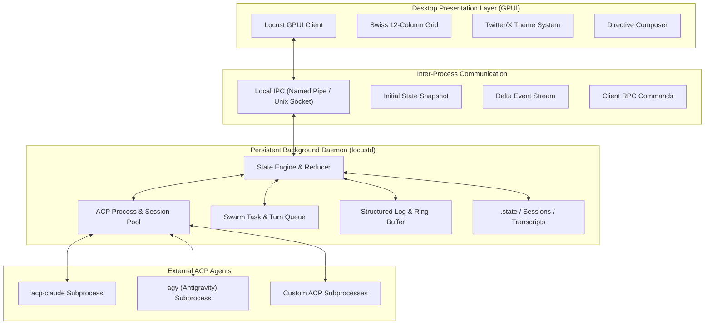

# Locust GPUI Forward Port & Architecture Plan

## Executive Summary
This document specifies the complete forward port of Locust from a terminal application (Ratatui/Crossterm) to a high-performance GPU-accelerated desktop application (GPUI), underpinned by a persistent background daemon architecture.

The project transitions from a monolithic terminal loop to a decoupled Client-Server architecture:
1. `locustd` (Headless Daemon / Server): Runs persistently in the background. Manages ACP agent processes, swarm execution queues, handoff state machines, token telemetry, and session persistence across GUI restarts.
2. `locust` (GPUI Desktop Client): A high-performance GUI client styled with a Swiss Grid layout and a Twitter/X dark aesthetic. Connects to the daemon via local IPC (Named Pipes on Windows, Unix Domain Sockets on POSIX).
3. Complete Ratatui & Crossterm Elimination: All terminal rendering and synchronous polling code is permanently excised.



---

## 1. System Topology & Client-Server Architecture

### 1.1 The Daemon Lifecycle (`locustd`)
Currently, when Locust terminates, all child agent processes terminate with it.
Under the new architecture:
- `locustd` runs as an independent daemon or background service bound to a project root.
- If no daemon is running when `locust` (GUI) launches, the GUI transparently spawns `locustd` in detached mode.
- When the GUI closes (via window close, `Ctrl+Q`, or OS shutdown), `locustd` remains running.
- Agents continue streaming turns, processing handoffs, and evaluating directives without interruption.
- When the GUI re-launches, it reconnects to the existing IPC endpoint and receives an instant state replay.

### 1.2 IPC Protocol Specification
Communication occurs over a high-throughput framed IPC channel:
- Windows: `\\.\pipe\locust-{project_hash}`
- Linux/macOS: `/tmp/locust-{project_hash}.sock`

Framing: 4-byte little-endian message length prefix followed by UTF-8 JSON payload.

#### Message Types: Client to Server (Requests & Commands)
```rust
#[derive(Debug, Serialize, Deserialize)]
#[serde(tag = "type", content = "payload")]
pub enum ClientCommand {
    /// Initial handshake and version negotiation
    Hello { client_version: String },
    /// Submit interactive chat turn from Controller pane
    SubmitControllerTurn { text: String },
    /// Direct task dispatch to an agent pane
    DispatchTask { target_pane: String, prompt: String },
    /// Cancel an in-flight turn on a pane
    CancelTurn { pane_name: String },
    /// Retry a failed turn on a pane
    RetryTurn { pane_name: String },
    /// Respond to a human-in-the-loop permission request
    ResolvePermission { request_id: String, allowed: bool },
    /// Change active swarm project directory
    SwitchProject { path: String },
    /// Filter or query log buffer
    QueryLogs { min_level: LogLevel, agent_id: Option<String>, limit: usize },
    /// Graceful daemon termination request
    ShutdownServer,
}
```

#### Message Types: Server to Client (Events & Snapshots)
```rust
#[derive(Debug, Serialize, Deserialize)]
#[serde(tag = "type", content = "payload")]
pub enum ServerEvent {
    /// Full state tree sent immediately upon client connection
    InitialSync { state: Box<AppStateSnapshot>, server_version: String },
    /// Incremental model update
    StateDelta(StateDelta),
    /// Real-time streaming chunks from agent turn
    TurnProgress {
        pane_name: String,
        delta_type: ProgressType, // Text, Thinking, ToolCall, ToolResult
        content: String,
    },
    /// Permission modal trigger
    PermissionRequested(PermissionRequest),
    /// Structured log emitted
    LogEmitted(LogEntry),
    /// Error notification
    ErrorAlert { title: String, message: String },
}
```

---

## 2. State Management Architecture

### 2.1 Decoupled State Engine
State management is isolated from all UI frameworks. The state tree lives inside `locustd` and implements an immutable-state/action-reducer pattern with sequence revision numbers.

```rust
pub struct StateEngine {
    state: AppState,
    revision: u64,
    event_subscribers: Vec<Sender<ServerEvent>>,
    history: RingBuffer<StateDelta>,
}
```

Key guarantees:
1. Determinism: Every state transition is executed via strongly typed Actions (`apply_action(&mut self, action: Action)`).
2. Optimistic GUI Updates: The GPUI client updates local view state optimistically and reconciles against the daemon revision counter.
3. Crash Recovery: The state engine flushes dirty snapshots to `.state/snapshot.json` every 5 seconds or upon critical turn milestones.

### 2.2 Reconnection Reconciliation
When a GPUI client reconnects:
1. Client sends `Hello { client_version }`.
2. Daemon sends `InitialSync { state, server_version }`.
3. Client resets its local GPUI entity models (`gpui::Model<AppState>`) with the fresh snapshot.
4. Active streaming progress continues without dropped frames.

---

## 3. Persistent Sessions & ACP Process Pooling

### 3.1 Background Process Management
- Subprocesses (`acp-claude`, `agy`, mock agents) are owned by `locustd`'s `acp::Manager`.
- Subprocess standard I/O streams are processed on dedicated asynchronous worker threads.
- If a child process crashes, `locustd` isolates the failure, updates the state tree to `Status::Failed(error)`, and preserves the full session transcript.

### 3.2 Multi-Layer Session Persistence
Sessions persist across three storage tiers:
1. Memory Cache: Active ACP connection pool in `locustd`.
2. Session Registry: `.state/acp_sessions.json` maps agent spec IDs and pane keys to active ACP session identifiers.
3. Transcripts & Telemetry: Transcripts persist to `.locust/runs/<timestamp>/<pane>.md`, and telemetry records persist to SQLite or structured JSON at `.state/telemetry.json`.

---

## 4. Structured & Persistent Logging System

### 4.1 Log Engine Design
Replace the current ad-hoc `logging.rs` with a zero-allocation, structured logging engine:
- Log Sinks:
  1. Ring Buffer Sink: Retains the latest 5,000 structured log records in memory for instant retrieval by the GPUI log viewer.
  2. Persistent Disk Sink: Writes timestamped, secret-redacted logs to `.locust/locust.log` with automatic log rotation (10 MB cap, 3 backups).
  3. IPC Stream Sink: Broadcasts logs matching client filter criteria in real time.

### 4.2 Structured Log Schema
```rust
#[derive(Debug, Clone, Serialize, Deserialize)]
pub struct LogEntry {
    pub id: u64,
    pub timestamp: String,
    pub level: LogLevel,     // Trace, Debug, Info, Warn, Error
    pub target: LogTarget,   // AcpWire, SwarmRouter, ProcessManager, AuthAudit, UI
    pub agent: Option<String>,
    pub message: String,
    pub fields: HashMap<String, String>,
}
```

---

## 5. GPUI Presentation Layer: Swiss Grid & Twitter/X Aesthetic

### 5.1 Design System & Aesthetic Principles

#### 1. Swiss International Typographic Style
- 12-Column Asymmetric Grid: Strict vertical and horizontal alignment guidelines. All panels adhere to proportional column spans (e.g., 3-column navigation, 6-column main feed, 3-column telemetry inspector).
- Information Density: Zero useless padding, zero decorative skeuomorphism. Clean functional layout.
- High-Contrast Hierarchy: Bold sans-serif headers (Geist / Inter / Helvetica Neue), monospaced data blocks (Geist Mono / JetBrains Mono).
- Hairline Dividers: 1px high-contrast borders replacing heavy shadows.

#### 2. Twitter / X Visual Theme
- Palette:
  - Background Base: `#000000` (True pitch black).
  - Surface Elevated: `#16181C` (Dark secondary containers).
  - Surface Hover: `#1E2024` (Hover state for rows and cards).
  - Hairline Border: `#2F3336` (Subtle boundary borders).
  - Primary Text: `#E7E9EA` (Crisp white).
  - Muted Text: `#71767B` (Secondary status and labels).
  - Accent / Link: `#1D9BF0` (Signature blue).
  - Success / Active: `#00BA7C` (Vibrant emerald).
  - Danger / Error: `#F4212E` (Vibrant crimson).
  - Warning / Thinking: `#FFD400` (Bright amber).
- Component Styling:
  - Timeline Cards: Turns, handoffs, and tool invocations rendered as clean activity cards with avatar badges and timestamp headers.
  - Rounded Pill Badges: Status pills (`rounded-full px-2.5 py-0.5 text-xs font-medium`).
  - Minimal Composer: Bottom interactive directive box styled like Twitter's post composer with inline token gauge, syntax highlighting, and quick-action tool buttons.

### 5.2 Layout Architecture

```
+-------------------------------------------------------------------------------------------------------+
|  LOCUST // SWISS GRID COCKPIT                                       [Project: /locust]  [12.4k tok]  |
+---------+---------------------------------------------------+-----------------------------------------+
| Col 1-2 | Col 3-8                                           | Col 9-12                                |
| NAV     | TIMELINE & AGENT TRANSCRIPT FEED                  | INSPECTOR & TELEMETRY                   |
|         |                                                   |                                         |
| [o] Dash| @claude [Spec: acp-claude] [Running] 2m ago       | ACTIVE AGENTS                           |
| [o] Svr | +-----------------------------------------------+ | . claude  (9.2k tok) [Thinking]         |
| [o] Swm | | > Thinking: Analyzing AST structure...        | | . agy     (3.2k tok) [Idle]             |
|         | |                                               | |                                         |
| PANES   | | I found 3 files requiring refactoring.        | | RUN LIMITS & METRICS                    |
| . arch  | | ```rust                                       | | Turn Cap:     [========--] 8/10         |
| . impl  | | fn migrate() -> Result<()>                    | | Tokens:       [====------] 12.4k / 50k  |
| . test  | | ```                                           | | Cost:         $0.0384 USD               |
|         | +-----------------------------------------------+ |                                         |
| LOGS    |                                                   | RECENT HANDOFFS                         |
| . Live  | @agy [Spec: agy] [Done] 30s ago                   | [Done] arch -> impl                     |
| . RPC   | Handoff accepted: starting test generation.       | [Pend] impl -> test                     |
|         +---------------------------------------------------+-----------------------------------------+
|         | DIRECTIVE COMPOSER (Twitter Styled)                                                         |
|         | @[impl]: Implement the new IPC server listener | [Send Turn] (Donut Gauge: 80% cap)         |
+---------+---------------------------------------------------------------------------------------------+
```

### 5.3 GPUI Component Hierarchy
```
RootView
├── TopHeader (Project status, global token counter, connection indicator)
├── MainGrid (12-column flexbox container)
│   ├── LeftSidebar (Cols 1-2: Tabs, agent pane selector, log view switcher)
│   ├── CenterFeed (Cols 3-8: Virtualized activity feed, turn transcripts, thinking blocks)
│   │   ├── TimelineList (Virtual uniform_list of agent turns)
│   │   └── DirectiveComposer (Text input, directive autocomplete, dispatch buttons)
│   └── RightInspector (Cols 9-12: Swarm status, telemetry gauges, active handoffs)
└── ModalsLayer (Floating overlays with backdrop blur)
    ├── PermissionModal (Tool authorization prompt with countdown bar)
    ├── ProjectSwitcherModal (Recent project list and path selector)
    └── TaskBoardModal (Full-screen handoff Kanban)
```

---

## 6. Removal of Ratatui and Crossterm

All terminal dependencies and drawing routines will be excised:
1. `src/app/view.rs` (2,037 lines): Deleted completely.
2. `src/app/controller.rs` (815 lines): Deleted completely. Replaced by `src/daemon/controller.rs` and `src/gui/controller.rs`.
3. `Cargo.toml`: Remove `ratatui` and `crossterm` entries.
4. Terminal signal hooks and raw-mode handlers: Removed.

---

## 7. Implementation Breakdown & Milestones

### Milestone 1: IPC Engine and Daemon Architecture
- Build `src/ipc/` module implementing framed JSON-RPC over Windows Named Pipes and Unix Domain Sockets.
- Build `src/daemon/` binary and service manager.
- Implement background process detachment and lifecycle controls.
- Deliverables: Headless server runs, responds to `ClientCommand`, and broadcasts `ServerEvent`.

### Milestone 2: State Engine & Structured Logging
- Move `src/app/model.rs` into `src/core/state.rs` with deterministic action-reducer mutations.
- Implement `src/logging/` structured ring buffer and disk rotation engine.
- Wire ACP Manager events directly into the State Engine.
- Deliverables: Server tracks full swarm state and emits delta events over IPC.

### Milestone 3: Ratatui & Crossterm Deletion
- Remove `ratatui = "0.30.2"` and `crossterm = "0.29.0"` from `Cargo.toml`.
- Remove `src/app/view.rs`.
- Update `src/main.rs` to route CLI arguments (`--check`, `--usage`, `--server`) without terminal UI.
- Deliverables: Codebase compiles without terminal crates; all 155 existing unit and mock tests pass.

### Milestone 4: GPUI Integration & Swiss Grid / Twitter Theme
- Add `gpui` dependency and configure platform backends.
- Implement Swiss Grid system tokens, typography scales, and Twitter dark palette.
- Implement base layout: Header, 12-column grid container, and status bar.
- Deliverables: Native desktop window opens and displays empty Swiss Grid dashboard.

### Milestone 5: Views, Timeline Feed & Directive Composer
- Implement `TimelineFeed` with virtualized turn cards, collapsible `<thinking>` blocks, and syntax-highlighted code.
- Implement `DirectiveComposer` with Twitter-style action bar and `@pane` autocomplete.
- Implement `RightInspector` with token progress donuts and handoff status list.
- Implement floating modals (Permission prompt with timer, Project switcher).
- Deliverables: Full interactive GUI functionality connected to live daemon.

### Milestone 6: Persistent Sessions & Reconnection Hardening
- Implement auto-spawn daemon logic when GUI launches.
- Implement graceful GUI disconnection (daemon continues processing turns).
- Implement GUI reconnection with instant state replay.
- Deliverables: End-to-end multi-agent swarm run continues after closing GUI and reconnects seamlessly.

---

## 8. Detailed File-by-File Blueprint

```
E:\Locust\
├── Cargo.toml                  [MODIFY] Remove ratatui/crossterm, add gpui, tokio, interprocess
├── src/
│   ├── main.rs                 [MODIFY] CLI router: GUI launcher vs. Headless Server daemon
│   ├── core/                   [NEW]
│   │   ├── mod.rs
│   │   ├── state.rs            [MOVED/REFACTORED from src/app/model.rs]
│   │   ├── telemetry.rs        [MOVED from src/app/telemetry.rs]
│   │   └── types.rs
│   ├── ipc/                    [NEW]
│   │   ├── mod.rs
│   │   ├── framing.rs          [Length-delimited byte stream framing]
│   │   ├── protocol.rs         [ClientCommand & ServerEvent schemas]
│   │   ├── server.rs           [Named pipe / socket listener]
│   │   └── client.rs           [IPC client connector for GPUI]
│   ├── daemon/                 [NEW]
│   │   ├── mod.rs
│   │   ├── server.rs           [Background daemon entry & event multiplexer]
│   │   └── session_manager.rs  [Persistent session & ACP runner]
│   ├── gui/                    [NEW]
│   │   ├── mod.rs
│   │   ├── app.rs              [GPUI App lifecycle & window manager]
│   │   ├── theme.rs            [Swiss Grid & Twitter/X color/typography tokens]
│   │   ├── components/
│   │   │   ├── header.rs       [Top status & project bar]
│   │   │   ├── sidebar.rs      [Navigation & pane selector]
│   │   │   ├── timeline.rs     [Twitter-style turn feed]
│   │   │   ├── composer.rs     [Interactive directive composer]
│   │   │   └── inspector.rs    [Telemetry & handoff cards]
│   │   └── modals/
│   │       ├── permission.rs   [Floating tool permission dialog]
│   │       └── project.rs      [Project switcher overlay]
│   ├── acp/                    [REUSED] Reused directly across daemon
│   ├── swarm/                  [REUSED] Reused directly across daemon
│   ├── logging.rs              [MODIFY] Overhauled with structured ring buffer
│   ├── project.rs              [REUSED] Reused directly across daemon
│   ├── redact.rs               [REUSED] Reused directly across daemon
│   └── app/
│       ├── view.rs             [DELETE] Completely removed
│       └── controller.rs       [DELETE] Completely removed
```

---

## 9. Verification & Quality Gates

### Automated Checks
1. Headless Core Test Suite:
   `cargo test --lib`
   - Verifies all ACP protocol parsing, swarm configuration validation, and state reducer transitions without any UI or display server.
2. IPC Integration Suite:
   `cargo test --test ipc_roundtrip`
   - Spawns daemon on ephemeral pipe/socket, connects test client, tests `InitialSync`, delta events, command dispatch, and reconnection.
3. Subprocess & Mock ACP Suite:
   `cargo test --test mock_acp`
   - Verifies multi-agent turn loops, timeouts, and permission gates against mock agents in headless daemon mode.
4. Headless GPUI Suite:
   `cargo test --test gui_views`
   - Uses `gpui::TestAppContext` to verify element tree layouts, action dispatching, and theme token rendering.

### Manual Verification
1. Server Independence:
   - Launch `locust --server`.
   - Start multi-agent turn (`@[coder]: build feature`).
   - Launch `locust` (GUI); verify live turn is rendering.
   - Kill GUI process (`kill` / window close); verify `locustd` keeps running and agent completes turn.
   - Re-open GUI; verify turn output and state are fully preserved.
2. Theme & Layout Fidelity:
   - Verify strict 12-column Swiss grid alignment across window resize events.
   - Verify Twitter dark palette (`#000000`, `#16181C`, `#2F3336`, `#1D9BF0`).
   - Verify interactive composer supports directive syntax highlighting and keyboard shortcuts.
3. Permissions Flow:
   - Trigger external tool permission in agent turn.
   - Verify floating modal appears with active countdown timer and Allow/Deny actions.
