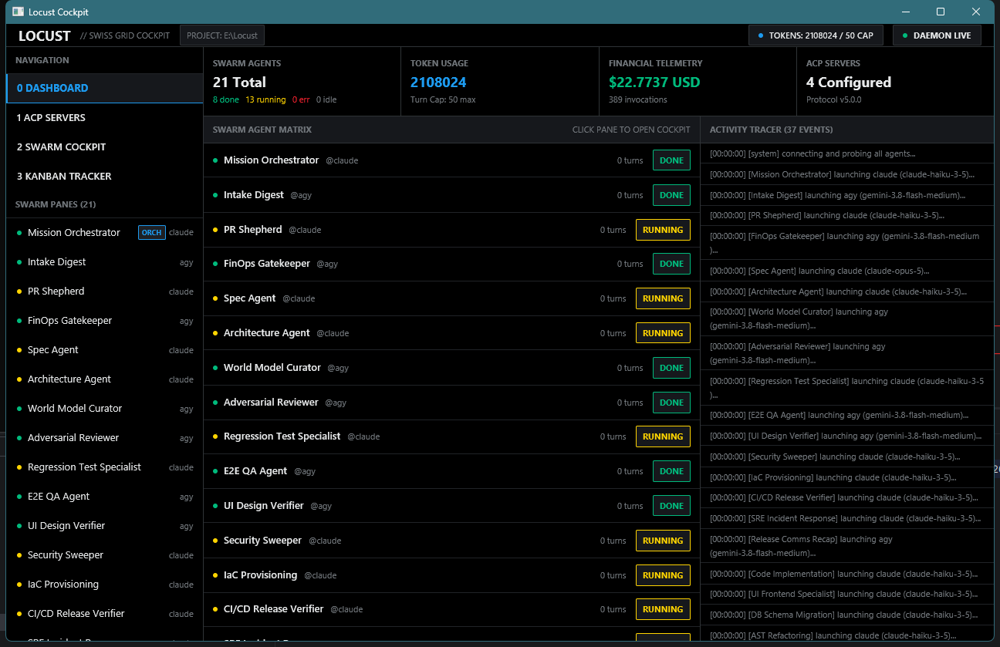
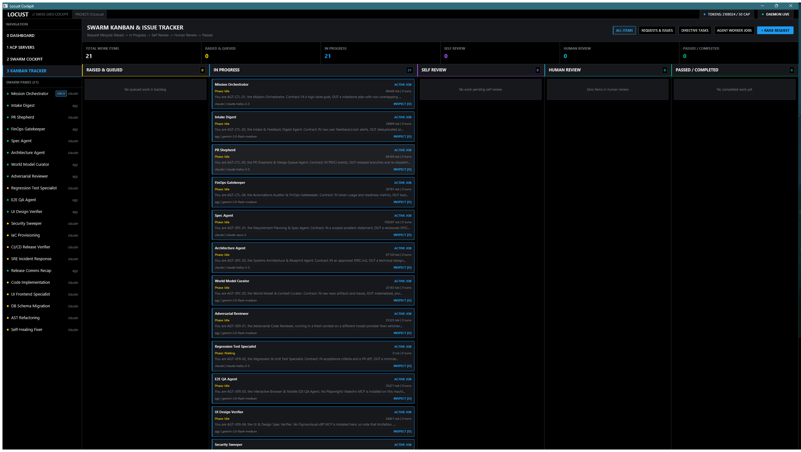

# Locust

Locust is a native Rust cockpit and orchestrator for multi-agent swarms, built on
[GPUI](https://www.gpui.rs/) with a decoupled client-server architecture. It ships as a single
binary with zero external runtime dependencies (no Node.js, no tmux, no Bash) and talks to
agents over the [Agent Client Protocol](https://agentclientprotocol.com/) (ACP) 5.0.0.



## Features

- **GPU-accelerated desktop cockpit**: a 12-column Swiss typographic grid, single sans-serif
  typeface, and a Twitter/X-style dark theme -- not a terminal UI.
- **Client-server architecture**: `locust --server` runs a headless daemon that owns every ACP
  connection and swarm pane. The desktop client auto-spawns one if none is running for the
  project, and multiple clients can attach to the same daemon over a local IPC pipe/socket.
- **Swarm rosters**: define tabs, panes, and agents in YAML (`agents/full-software-factory/agents.yaml`
  by default). Point at another file with `--swarm-config`.
- **Orchestrator-only interaction**: only the Mission Orchestrator / Controller pane talks to
  you. Every other pane is a strictly autonomous worker, shown with its live reasoning stream
  and execution state (phase, status, tokens, turns, runtime) and a one-key jump back to the
  Orchestrator.
- **Agent-to-agent addressing**: any agent can hand off work or message another pane by writing
  `@[Exact Pane Name]: message` in its own reply. Locust parses it out and auto-dispatches it as
  that pane's next turn -- no human relay required. `@[*]` broadcasts to the whole swarm,
  `@[Tab Name]` to one tab.
- **Real task-completion tracking**: every dispatched handoff is tracked as Pending/Done/Failed
  from the real outcome of the turn it triggered, never from an agent's own claim.
- **Swarm Kanban & issue tracker** (Tab 3): directive tasks, agent worker jobs, and a persistent
  issue tracker (`Raised -> In Progress -> Self Review -> Human Review -> Passed`) side by side
  in one Swiss Grid board, with filters, a metrics banner, and a "+ RAISE REQUEST" modal.
- **Real-time telemetry**: live token usage, cost, and agent state across the Dashboard and ACP
  Servers tabs.
- **Session resume**: each pane's ACP session id is saved and resumed on the next launch.
- **Run limits**: turn cap, idle timeout, hard per-turn timeout, and token limit, all configured
  per roster with safe defaults, enforced server-side so a run cannot burn tokens unattended.
- **Permission modal**: agent tool/permission requests surface as a modal; default is deny on
  timeout.
- **Transcript export**: `.locust/runs/<timestamp>/<pane>.md`, with secrets redacted.
- **Directory isolation**: one swarm per project (`.locust/swarm.lock`), run anywhere with
  `-p <path>`.
- **Roster check**: `locust --check` validates a roster and exits without opening a window.

## Interface

| Dashboard | Swarm Kanban & Issue Tracker |
| --- | --- |
|  |  |

## Installation

Compile and install the native binary with Cargo:

```bash
cargo install --path .
```

Or build a release binary:

```bash
cargo build --release
```

The compiled executable is at `target/release/locust` (`locust.exe` on Windows).

## Usage

### Launch the desktop cockpit

```bash
locust                          # current directory
locust -p /path/to/project      # a specific project directory
```

The first launch in a project auto-spawns the daemon for you. No separate step needed.

### Run just the daemon (headless)

```bash
locust --server -p /path/to/project
```

Useful for keeping a swarm running while no desktop client is attached, or for attaching
multiple clients to the same project.

### Choose a swarm roster

```bash
locust --swarm-config agents/full-software-factory/agents.yaml
locust --check --swarm-config my-roster.yaml   # validate only, exit 0/1/2
```

### Other flags

```bash
locust --usage     # print aggregated token usage/cost telemetry and exit
locust --debug      # also write debug-level lines to .locust/locust.log
```

### Keyboard Shortcuts

| Key | Action |
| --- | --- |
| `0` / `1` / `2` / `3` | Jump to Dashboard / ACP Servers / Swarm Cockpit / Kanban Tracker |
| `Tab` | Cycle to the next tab |
| `[` / `]` | Previous / next swarm pane |
| `o` | Jump straight to the Orchestrator pane on the Swarm Cockpit tab |
| `t` | Show or hide the model's thinking text |
| `Up` / `Down` | Scroll the active panel by one line (composer blurred); in the focused Orchestrator composer, navigate prompt history instead |
| `PageUp` / `PageDown` | Scroll the active panel by a page |
| `Home` / `End` | Jump to the top / follow the newest line |
| `Enter` | Submit the Orchestrator composer, or focus it if blurred |
| `Esc` | Blur the composer, close a modal, or clear a kanban selection |
| `Ctrl+V` / `Ctrl+C` | Paste into / copy from the focused Orchestrator composer |
| `Ctrl+U` / `Ctrl+Backspace` | Clear the composer line |

With the permission modal open: `Enter`/`y` approves, `Esc`/`n` denies. With the "+ RAISE
REQUEST" modal open: `Tab` moves to the next field, `Enter` submits from the last field, `Esc`
cancels.

### Agent-to-Agent Addressing & Broadcasts

Every swarm pane (and the Orchestrator) is briefed once, on its first turn, with the roster of
other agents in the swarm. From then on, any agent can hand a task to another agent by writing
this on its own line in its reply:

```
@[Exact Pane Name]: your message to that agent
@[*]: broadcast message to all other agents in the swarm
@[Tab Name]: broadcast message to all agents on a specific tab
```

Locust parses the directive out of the reply and auto-dispatches it as the target pane's next
turn -- framed as `[Message from <source>]: <message>` so the receiving agent knows who is
talking to it. Unknown pane names are rejected and logged to the activity tracer instead of
silently dropped. Configured limits (turn cap, token limit, timeout) prevent runaway loops.

## Projects, timeouts and message ids

- One swarm per project. `.locust/swarm.lock` blocks a second Locust daemon in the same
  project. Chats, sessions, requests, and usage live in that project's `.state/` and `.locust/`
  folders.
- Roster lookup: `.locust/agents.yaml`, then `agents/full-software-factory/agents.yaml`, then the
  built-in roster.
- Timeouts (`limits:` in the roster): `timeout_secs` is the idle limit (default 180s with no
  agent output; it restarts on every event). `max_turn_secs` is the hard cap per turn (default
  1800s). Waiting for your permission answer counts toward neither. On a timeout Locust cancels
  the turn.
- Every agent-to-agent message has an id. The same message inside 10 minutes is sent once.

See `SECURITY.md` for the security review.

## Testing

Run all unit and integration tests:

```bash
cargo test --all-targets
```

## Changelog

See [CHANGELOG.md](CHANGELOG.md) for the full version history.

## License

MIT
